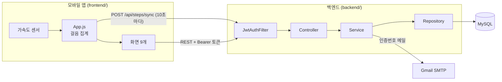

# WanderSteps — 걸음으로 세계를 여행하는 앱

> 걷는 만큼 세계 랜드마크에 가까워집니다.

스마트폰 가속도 센서로 걸음 수를 재고, 누적 걸음 수가 목표에 닿으면
해운대 → 오사카성 → 에펠탑 → … 순서로 세계 랜드마크를 하나씩 해금하는 **걷기 게임화 앱**입니다.
친구와 랭킹을 겨루고 업적을 모을 수 있습니다.

| | |
|---|---|
| **모바일 앱** | React Native (Expo 54) · React Navigation · expo-sensors · expo-secure-store |
| **백엔드** | Java 22 · Spring Boot 3.5 · Spring Security + JWT · Spring Data JPA · MySQL 8 |
| **기타** | Gmail SMTP(이메일 인증) · JUnit 5 + H2(테스트) |

## 주요 기능

- **걸음 측정·동기화** — 가속도 센서로 걸음을 세고 10초마다 서버에 동기화
- **랜드마크 여행** — 누적 걸음 수에 따라 8곳의 랜드마크 해금, 해금 시 알림과 칭호 획득
- **랭킹** — 주간·월간·구(區)별·친구 랭킹
- **업적** — 누적 걸음, 연속 달성일, 해금한 랜드마크 수 등 조건별 업적
- **친구** — 닉네임 검색 → 친구 요청 → 알림에서 수락/거절
- **계정** — JWT 로그인, 이메일 인증번호로 아이디 찾기·비밀번호 재설정

## 구조



```
LandmarkApp
├── backend/                Spring Boot API 서버
│   └── src/main/java/project/landmark
│       ├── config/         보안(인증 규칙·CORS), 개발용 초기 데이터
│       ├── controller/     REST API
│       ├── dto/            요청·응답 객체
│       ├── entity/         JPA 엔티티
│       ├── exception/      전역 예외 처리 (모든 오류를 같은 JSON 형식으로)
│       ├── repository/     Spring Data JPA
│       ├── security/       JWT 발급·검증, 이메일 인증번호 저장소
│       └── service/        비즈니스 로직
└── frontend/               Expo 모바일 앱 (자세한 화면 설명은 frontend/README.md)
    └── src/
        ├── screens/        로그인, 홈, 랜드마크, 랭킹, 업적, 프로필, 친구
        ├── constants/      서버 주소
        └── utils/          토큰 저장소 (앱: SecureStore, 웹: localStorage)
```

## 실행 방법

### 1. 백엔드

```bash
cd backend
```

1. MySQL에 데이터베이스를 만듭니다.

   ```sql
   CREATE DATABASE landmark DEFAULT CHARACTER SET utf8mb4;
   ```

2. `application-local.yml.example`을 `application-local.yml`로 복사하고 값을 채웁니다.
   이 파일은 `.gitignore`에 들어 있어 저장소에 올라가지 않습니다.

   | 항목 | 설명 |
   |---|---|
   | `spring.mail.username` / `password` | Gmail 주소와 앱 비밀번호 (Google 계정 → 보안 → 앱 비밀번호) |
   | `spring.datasource.username` / `password` | MySQL 계정 |
   | `jwt.secret` | JWT 서명 키, 32자 이상의 임의 문자열 |

   파일 대신 환경변수 `MAIL_USERNAME`, `MAIL_PASSWORD`, `DB_USERNAME`, `DB_PASSWORD`, `JWT_SECRET`을 써도 됩니다.

3. 서버를 실행합니다.

   ```bash
   ./gradlew bootRun        # Windows: gradlew.bat bootRun
   ```

   처음 실행하면 랜드마크(`data.sql`), 업적, 테스트 계정(`config/TestDataRunner`)이 자동으로 들어갑니다.
   배포할 때는 `--spring.profiles.active=prod`로 실행하면 테스트 계정을 만들지 않습니다.

### 2. 모바일 앱

```bash
cd frontend
npm install
npx expo start          # 휴대폰 Expo Go로 QR 스캔, 또는 w 키로 웹 실행
```

서버 주소는 `frontend/src/constants/constants.js`에서 정합니다.
웹은 `http://localhost:8080`, 휴대폰은 Expo 개발 서버를 띄운 PC의 IP(같은 와이파이)를 자동으로 씁니다.

### 3. 테스트

```bash
cd backend
./gradlew test
```

MySQL 없이 메모리 DB(H2)로 돌아갑니다. 설정은 `backend/src/test/resources/application.yml`에 있습니다.

## API

로그인(`POST /api/auth/login`)하면 JWT가 응답의 `data`로 옵니다. 이후 요청에는 `Authorization: Bearer <토큰>` 헤더를 붙입니다.
모든 응답은 `{"success": true|false, "message": "...", "data": ...}` 형식입니다.

| 구분 | 메서드 · 경로 | 로그인 |
|---|---|:---:|
| 회원 | `POST /api/auth/register` · `POST /api/auth/login` · `GET /api/auth/check-{username,nickname,email}` | |
| 아이디 찾기 | `POST /api/email-auth/send` → `POST /api/email-auth/verify` | |
| 비밀번호 재설정 | `POST /api/auth/check-reset-info`(인증번호 발송) → `POST /api/auth/reset-password` | |
| 홈 | `GET /api/home` | ✔ |
| 걸음 | `POST /api/steps/sync` | ✔ |
| 랜드마크 | `GET /api/landmarks` | |
| 랭킹 | `GET /api/ranking/{weekly,monthly}` · `GET /api/ranking/district/{구}` | |
| 친구 랭킹 | `GET /api/ranking/friends/{내 username}` | ✔ |
| 업적 | `GET /api/achievements` · `GET /api/achievements/{id}` | |
| 내 업적 | `GET /api/achievements/list` · `POST /api/achievements/{id}/claim` · `GET /api/achievements/user/{username}` | ✔ |
| 내 정보 | `GET /api/user/info` · `GET /api/user/titles` · `PUT /api/user/{title,nickname,image,status-message}` | ✔ |
| 친구 | `GET /api/friends` · `POST /api/friends` · `DELETE /api/friends/{nickname}` | ✔ |
| 알림 | `GET /api/notifications` · `GET /api/notifications/unread-count` · `DELETE /api/notifications/{id}` · `POST /api/notifications/{id}/{accept,reject}` | ✔ |

로그인이 필요한 API를 토큰 없이 부르면 **401**, 남의 데이터(알림·친구 랭킹)를 건드리면 **403**이 옵니다.

## 신경 쓴 부분

- **비밀 값 분리** — DB·메일 비밀번호와 JWT 키를 코드에서 빼고 `application-local.yml`/환경변수로 주입. JWT 키가 32바이트보다 짧으면 서버가 뜨지 않게 막았습니다.
- **이메일 인증번호** — `SecureRandom` 6자리, 5분 만료, 5회 실패 시 폐기, 한 번 쓰면 소멸. 비교는 `MessageDigest.isEqual`로 합니다.
- **권한 확인** — 알림 삭제·친구 요청 수락은 알림의 주인만 할 수 있고, Spring Security 401/403을 서비스 공통 JSON 형식으로 돌려줍니다.
- **위치 계산 일원화** — "현재 랜드마크 / 다음 목표" 계산을 `LandmarkPosition` 하나로 모아 홈·내 정보·친구·랭킹이 같은 결과를 보여 줍니다.
- **테스트** — 인증번호 저장소와 위치 계산 단위 테스트, H2로 앱 전체를 띄워 걸음 누적·인증 응답을 확인하는 통합 테스트.
